# Circle of Peer Facilitators (CPF) — Multi-Theme System Overview

Complete visual & functional walkthrough of **all 13 core CPF screens**, organized into **4 functional modules** and captured cleanly across **all 5 appearance themes** (`13 × 5 = 65` desktop screenshots at `1440×900`).

---

## Five Appearance Themes

| File | Theme Title | Switcher Label | Aesthetic Direction |
| --- | --- | --- | --- |
| `01_light.png` | **Soft Cream (Light)** | `Light` | Warm paper parchment (#FBF6EE), crisp charcoal typography, forest emerald (#15803D) & sky-blue highlights. |
| `02_dark.png` | **Twilight Calm (Dark)** | `Dark` | Deep charcoal-slate canvas built for evening sessions with soft muted borders and high-legibility off-white text. |
| `03_sunrise.png` | **Letter in Sunrise** | `Sunrise` | Sunlit pinkish-peach horizon warmth paired with terracotta surface accents and evening indigo details (.theme-sunrise). |
| `04_joy.png` | **In Little Blobs of Joy** | `Joy` | Eye-friendly warm cream backdrop layered with soft, calm pastel color blobs for approachable day-to-day browsing (.theme-joy). |
| `05_vice.png` | **Somehow, We Got Here Before Anything Worse** | `Vice` | Retro-dusk violet & neon sunset warmth (.theme-vice) paired with the streamlined lightning-bolt switcher badge. |

## Organized Module Contents

### PART I — Public Portal & Authentication
_Public-facing chapter discovery, peer mentorship showcase, and unified credential sign-in surfaces._

- [1. Public Landing Page & Campus Directory](#1-01-landing-page) — `screenshots/01-landing-page/` • `/  (Public — Guest & Authenticated)`
- [2. Chapter Member Sign-In Portal](#2-02-login-portal) — `screenshots/02-login-portal/` • `/login  (Public Guest Route)`

### PART II — Core Member & Chapter Operations
_Day-to-day peer dashboard, membership & Messenger GC roster, focused QR badge modal, and campus events._

- [3. Peer Facilitator Operations Dashboard](#3-03-peer-dashboard) — `screenshots/03-peer-dashboard/` • `/dashboard  (Authenticated Verified Member)`
- [4. CPF Membership & Messenger GC Checklist](#4-04-membership-roster) — `screenshots/04-membership-roster/` • `/membership  (Authenticated Verified Member)`
- [5. Focused Member Attendance QR Modal](#5-05-membership-qr-modal) — `screenshots/05-membership-qr-modal/` • `/membership  (Interactive Index-Badge Modal Overlay)`
- [6. Events, Calendar, QR Scanner & Optional Reflections](#6-06-events-activities) — `screenshots/06-events-activities/` • `/events-activities  (Authenticated Verified Member)`

### PART III — Community, Governance & Support Hubs
_Sequential elections with member photos, AES-256 time capsules, campus counseling/testing room hub, officers' GC, and SHA-256 credentials._

- [7. Campus Elections Chamber & Constitutional Billboard](#7-07-elections-chamber) — `screenshots/07-elections-chamber/` • `/community-hub  (Default Campus Elections Tab)`
- [8. AES-256 Time Capsules & Five Stationery Varieties](#8-08-time-capsules) — `screenshots/08-time-capsules/` • `/community-hub  (Time Capsules Tab)`
- [9. Campus Support & Operations Hub](#9-09-campus-operations) — `screenshots/09-campus-operations/` • `/campus-hub  (Authenticated Verified Member)`
- [10. Officers Private Group Chat & Annual ZIP Archives](#10-10-officers-chat) — `screenshots/10-officers-chat/` • `/officers-chat  (Officers, Advisers & Counselors)`
- [11. Blockchain-Protected Achievements, Awards & Certificates](#11-11-blockchain-credentials) — `screenshots/11-blockchain-credentials/` • `/my-credentials  (Authenticated & Public Verification)`

### PART IV — Personalization & Account Settings
_Single-avatar profile photo uploads for election seats, account preservation rules, and five-palette appearance controls._

- [12. Profile Information & Single Avatar Upload](#12-12-profile-and-photo) — `screenshots/12-profile-and-photo/` • `/settings/profile  (Authenticated Verified Member)`
- [13. Appearance Settings & Theme Palette Varieties](#13-13-appearance-themes) — `screenshots/13-appearance-themes/` • `/settings/appearance  (Authenticated Verified Member)`

---

## PART I — Public Portal & Authentication

> Public-facing chapter discovery, peer mentorship showcase, and unified credential sign-in surfaces.

### 1. Public Landing Page & Campus Directory

**Route:** `/  (Public — Guest & Authenticated)`  
**Screenshot Folder:** [`screenshots/01-landing-page/`](screenshots/01-landing-page/)

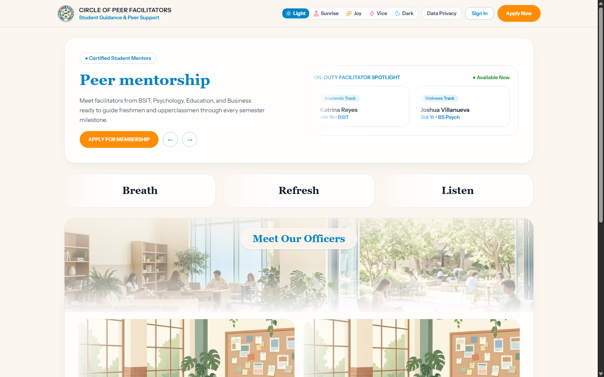
*Figure 1.1 — Primary baseline in Soft Cream (Light) (`01_light.png`).*

The public front door of Circle of Peer Facilitators (CPF) introduces CHMSU's Student Guidance & Peer Support ecosystem, spotlighting on-duty peer facilitators, officer rosters, Data Privacy disclosure, and membership applications. Visitors can preview all five visual themes right from the top navigation bar before signing in.

**Key Highlights:**
- On-Duty Facilitator Spotlight & Meet Our Officers cards highlighting BSIT, Psychology, Education, and Business peers.
- Integrated [aria-label='Theme Mode Switcher'] in the header supports Light, Sunrise, Joy, Vice, and Dark presets.
- Direct calls-to-action for Apply Now, Data Privacy notice, and chapter member Sign In.

#### All Theme Variants — Public Landing Page & Campus Directory

| Twilight Calm (Dark) (`02_dark.png`) | Letter in Sunrise (`03_sunrise.png`) |
| :---: | :---: |
| 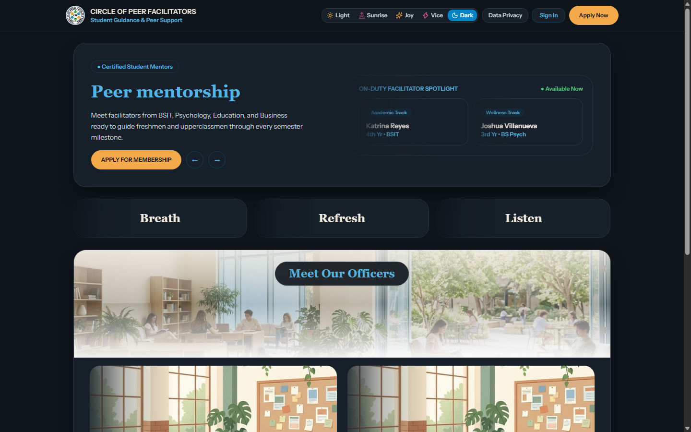 | 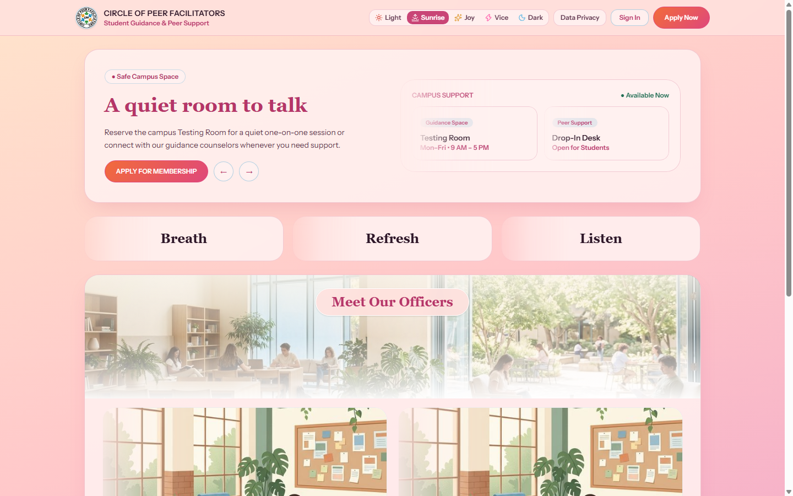 |

| In Little Blobs of Joy (`04_joy.png`) | Somehow, We Got Here Before Anything Worse (`05_vice.png`) |
| :---: | :---: |
| 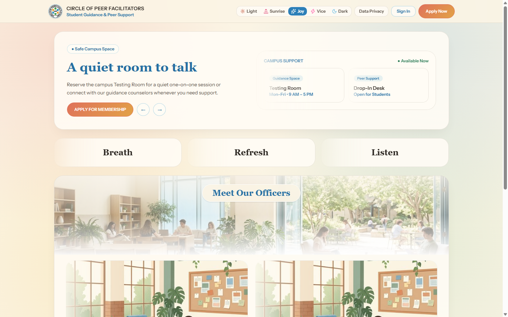 | 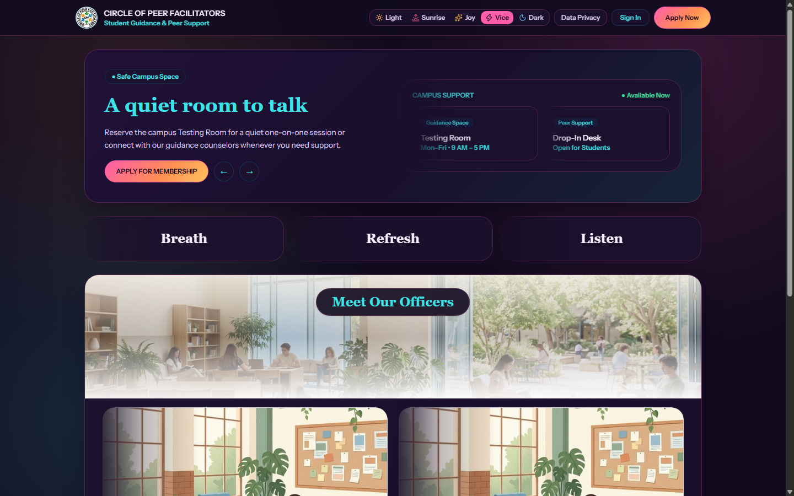 |

---

### 2. Chapter Member Sign-In Portal

**Route:** `/login  (Public Guest Route)`  
**Screenshot Folder:** [`screenshots/02-login-portal/`](screenshots/02-login-portal/)

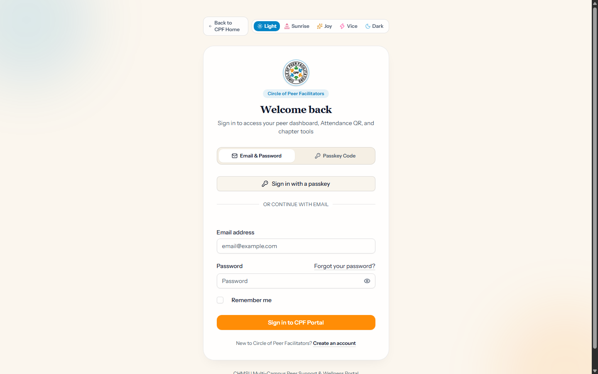
*Figure 2.1 — Primary baseline in Soft Cream (Light) (`01_light.png`).*

Built atop AuthSimpleLayout, the sign-in screen validates chapter accounts via email and password (with forced temporary-password rotation on first login for officer-added accounts) alongside single-use officer-issued passkey code authentication.

**Key Highlights:**
- Supports both standard email/password authentication and CPF passkey-code login.
- Retains full 5-theme styling and top-header Theme Mode Switcher across authentication views.
- Enforces EnsureTemporaryPasswordChanged middleware on first sign-in for newly onboarded peers.

#### All Theme Variants — Chapter Member Sign-In Portal

| Twilight Calm (Dark) (`02_dark.png`) | Letter in Sunrise (`03_sunrise.png`) |
| :---: | :---: |
| 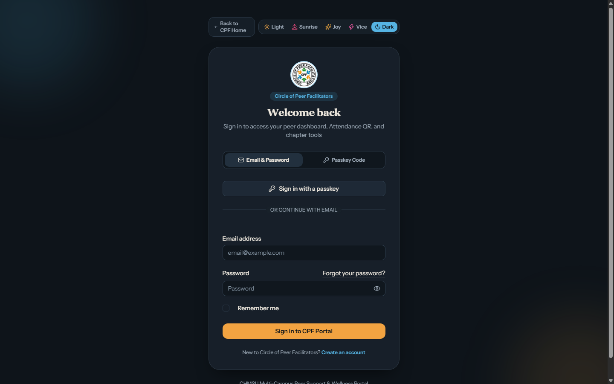 | 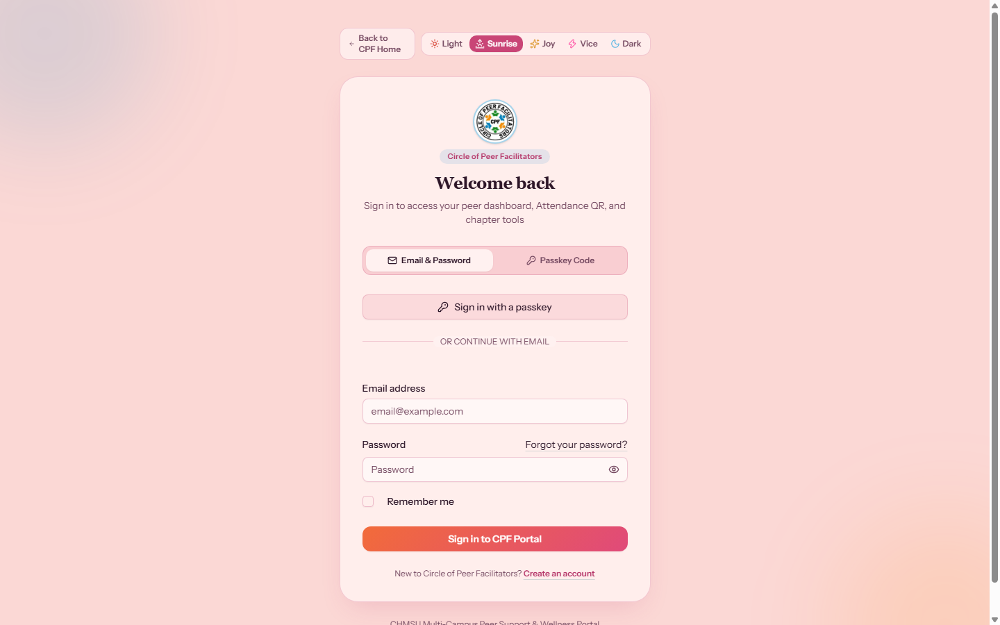 |

| In Little Blobs of Joy (`04_joy.png`) | Somehow, We Got Here Before Anything Worse (`05_vice.png`) |
| :---: | :---: |
| 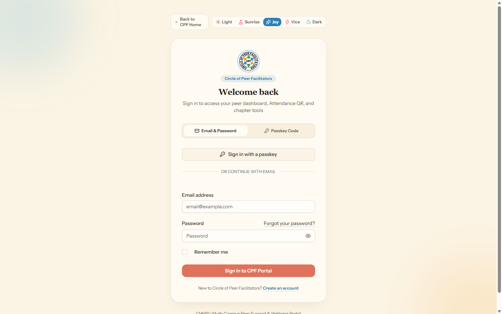 | 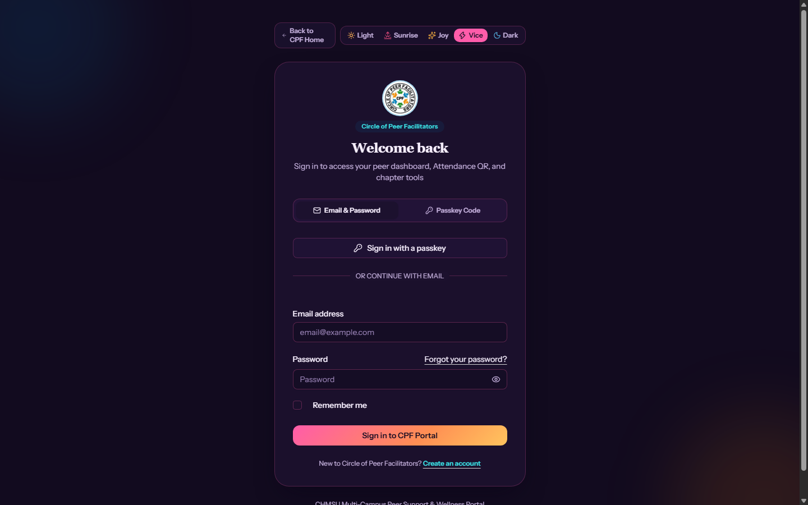 |

---

## PART II — Core Member & Chapter Operations

> Day-to-day peer dashboard, membership & Messenger GC roster, focused QR badge modal, and campus events.

### 3. Peer Facilitator Operations Dashboard

**Route:** `/dashboard  (Authenticated Verified Member)`  
**Screenshot Folder:** [`screenshots/03-peer-dashboard/`](screenshots/03-peer-dashboard/)

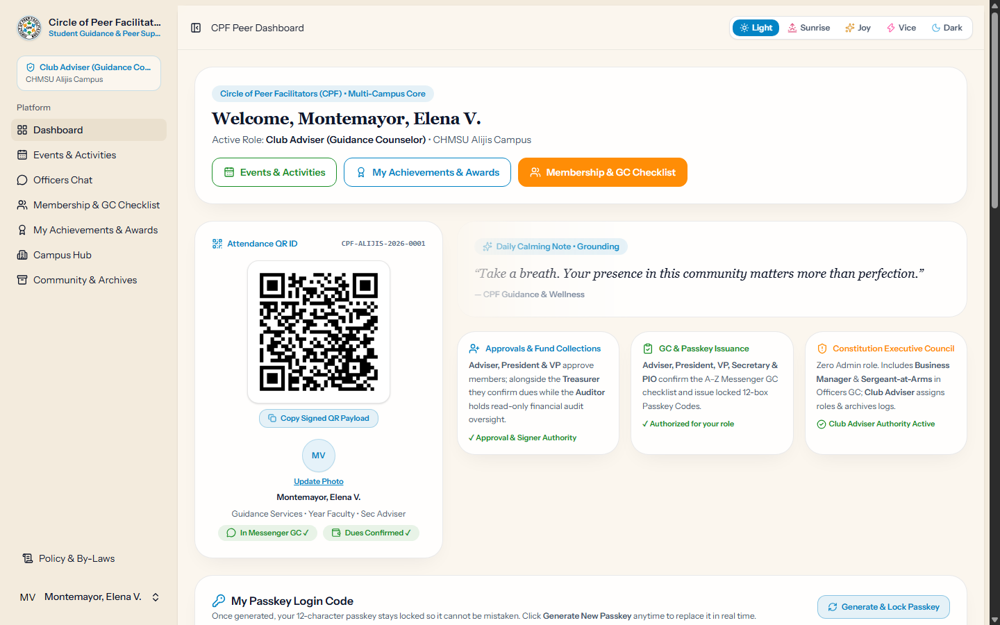
*Figure 3.1 — Primary baseline in Soft Cream (Light) (`01_light.png`).*

Once signed in, members and advisers land on the CPF Peer Dashboard showing their personal signed Attendance QR ID, Daily Calming Note grounding prompt, role-governance summary cards (Approvals & Fund Collections, GC & Passkey Issuance, Constitution Executive Council), and self-service 12-character Passkey Login Code generator.

**Key Highlights:**
- Personal Attendance QR ID panel with one-click Copy Signed QR Payload and Update Photo link.
- Daily Calming Note grounding widget paired with clear Zero Admin constitution authority cards.
- Dedicated My Passkey Login Code panel allowing real-time passkey generation and lock renewal.

#### All Theme Variants — Peer Facilitator Operations Dashboard

| Twilight Calm (Dark) (`02_dark.png`) | Letter in Sunrise (`03_sunrise.png`) |
| :---: | :---: |
| 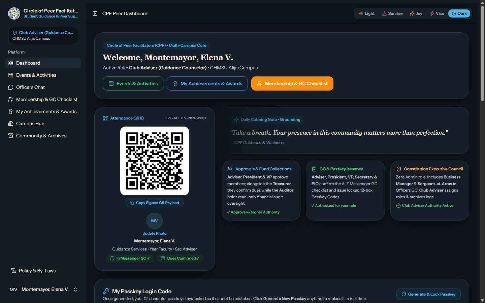 | 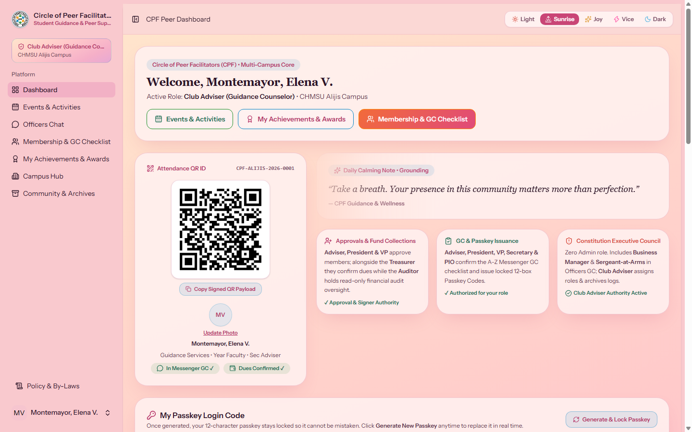 |

| In Little Blobs of Joy (`04_joy.png`) | Somehow, We Got Here Before Anything Worse (`05_vice.png`) |
| :---: | :---: |
| 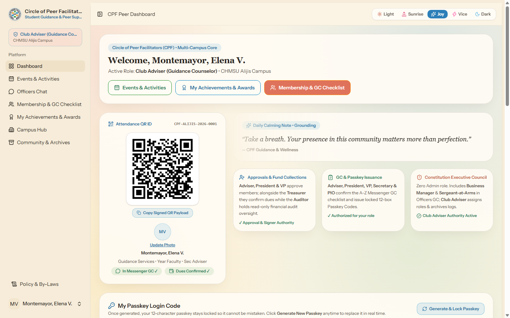 | 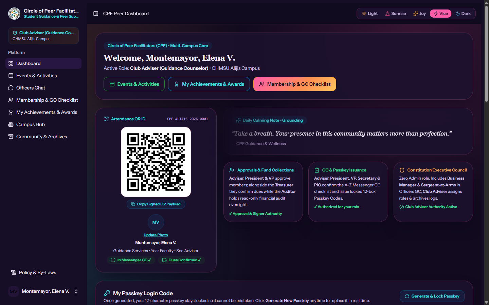 |

---

### 4. CPF Membership & Messenger GC Checklist

**Route:** `/membership  (Authenticated Verified Member)`  
**Screenshot Folder:** [`screenshots/04-membership-roster/`](screenshots/04-membership-roster/)

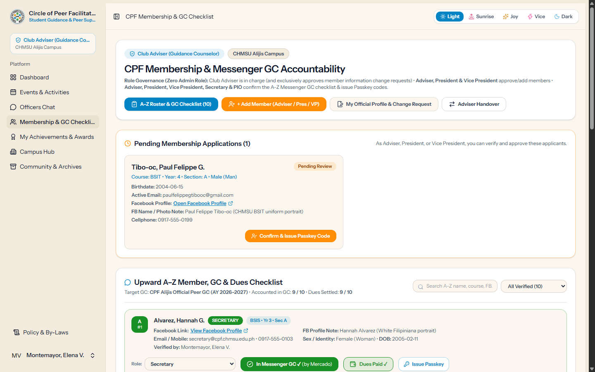
*Figure 4.1 — Primary baseline in Soft Cream (Light) (`01_light.png`).*

Centralizes Pending Membership Applications, the upward A-Z Member, GC & Dues Checklist, officer-assisted member onboarding, and Adviser handover tools. Each verified member row renders a clickable index pill (#1, #2, ...) that opens that member's streamlined Attendance QR modal.

**Key Highlights:**
- Adviser, President & VP approve applicants and issue Passkey Codes; Secretary & PIO verify A-Z GC inclusion.
- Upward A-Z Member, GC & Dues Checklist displays clickable #1..#N index badges to open each member's QR.
- Enforces Zero Admin constitution rules where Club Adviser holds exclusive member-info change approval.

#### All Theme Variants — CPF Membership & Messenger GC Checklist

| Twilight Calm (Dark) (`02_dark.png`) | Letter in Sunrise (`03_sunrise.png`) |
| :---: | :---: |
| 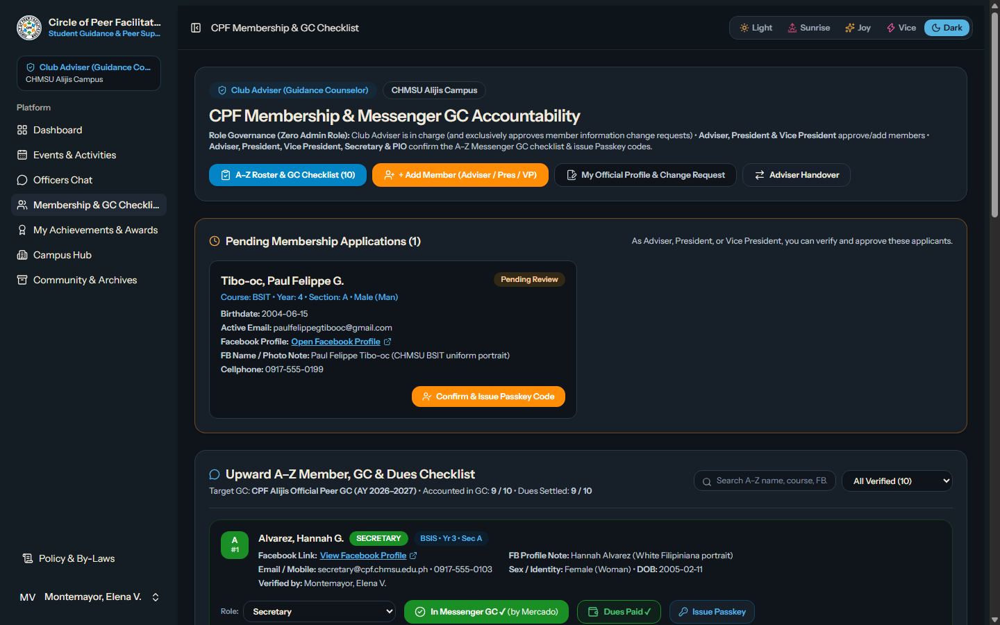 | 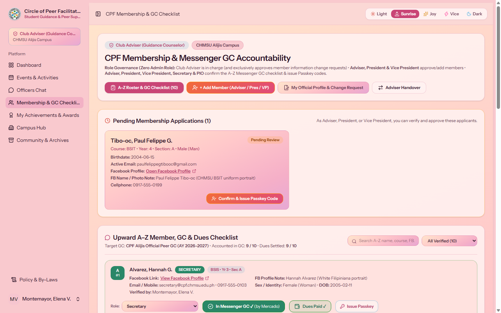 |

| In Little Blobs of Joy (`04_joy.png`) | Somehow, We Got Here Before Anything Worse (`05_vice.png`) |
| :---: | :---: |
| 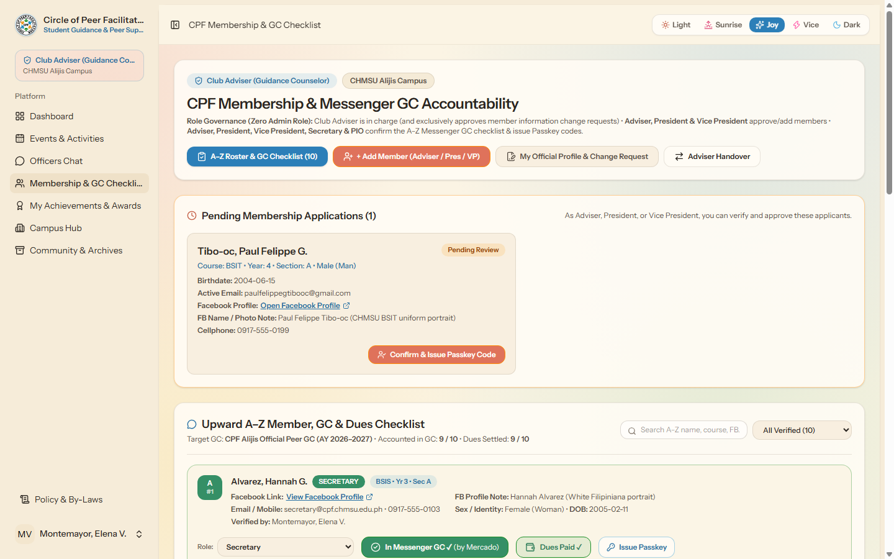 | 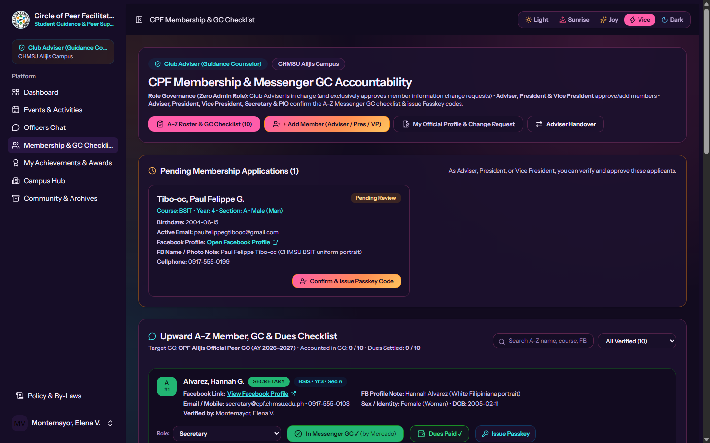 |

---

### 5. Focused Member Attendance QR Modal

**Route:** `/membership  (Interactive Index-Badge Modal Overlay)`  
**Screenshot Folder:** [`screenshots/05-membership-qr-modal/`](screenshots/05-membership-qr-modal/)

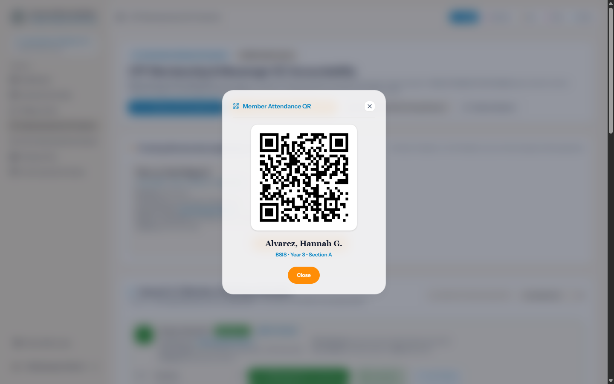
*Figure 5.1 — Primary baseline in Soft Cream (Light) (`01_light.png`).*

Clicking a member's index pill button inside the Membership Roster opens a crisp, focused QR badge overlay intentionally stripped down to the essentials required at event check-in booths: the scannable SVG QR matrix alongside the member's full name and Course, Year & Section.

**Key Highlights:**
- Displays strictly the scannable QR code (.cpf-qr-surface svg), Member Name, and Course/Year/Section.
- Contrast-safe white QR quiet-zone surface stays reliably scannable even under Dark, Sunrise, Joy, and Vice themes.
- Quickly dismissible via the top-right Close Member QR Modal control or backdrop interaction.

#### All Theme Variants — Focused Member Attendance QR Modal

| Twilight Calm (Dark) (`02_dark.png`) | Letter in Sunrise (`03_sunrise.png`) |
| :---: | :---: |
| 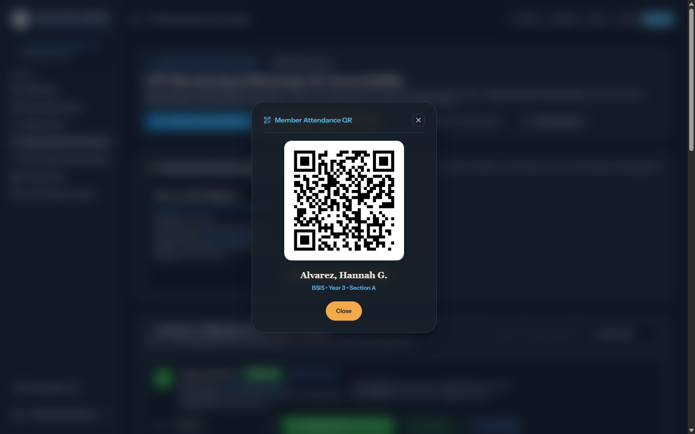 | 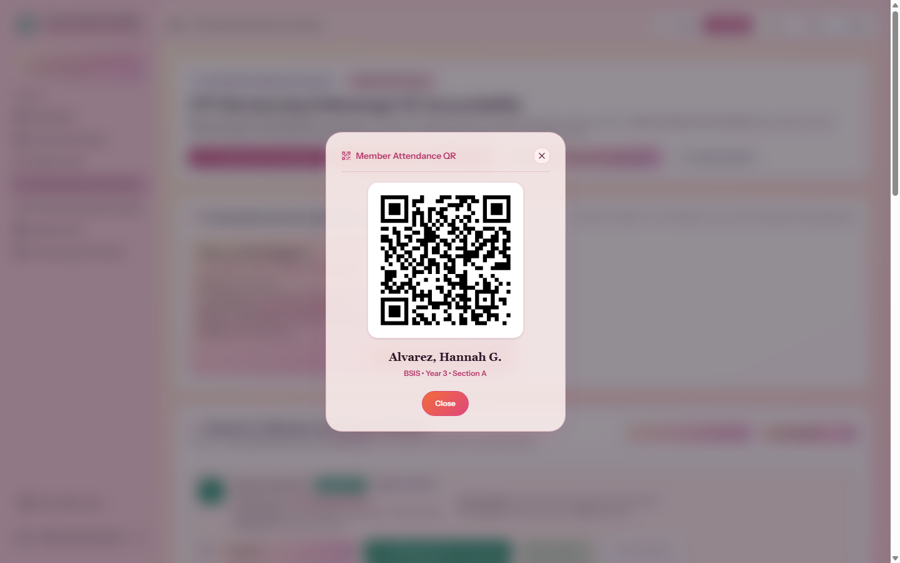 |

| In Little Blobs of Joy (`04_joy.png`) | Somehow, We Got Here Before Anything Worse (`05_vice.png`) |
| :---: | :---: |
| 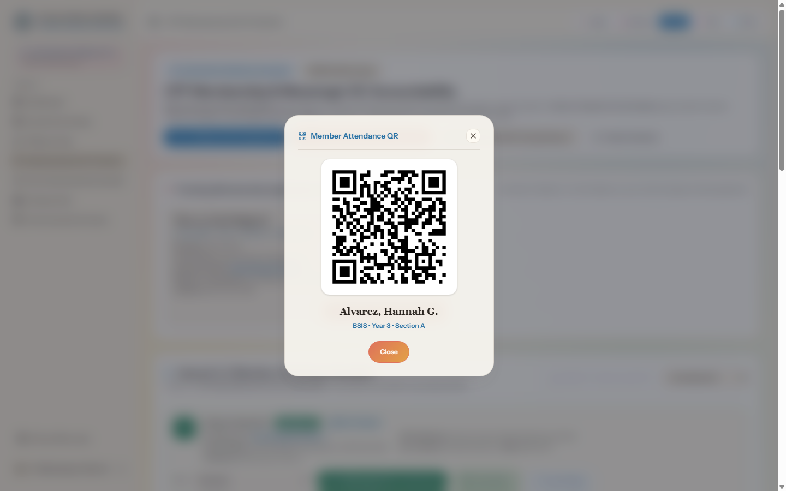 | 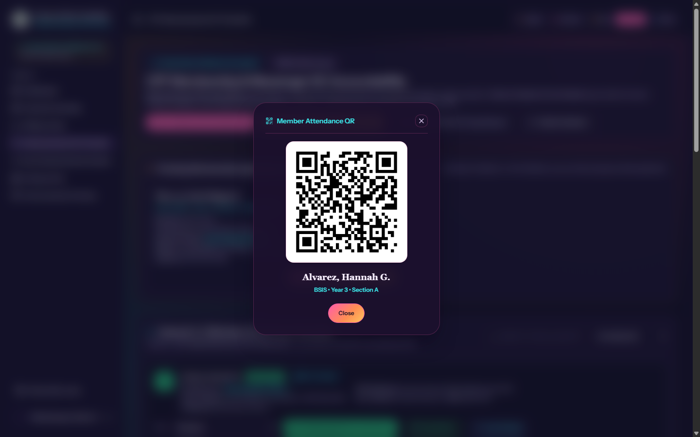 |

---

### 6. Events, Calendar, QR Scanner & Optional Reflections

**Route:** `/events-activities  (Authenticated Verified Member)`  
**Screenshot Folder:** [`screenshots/06-events-activities/`](screenshots/06-events-activities/)

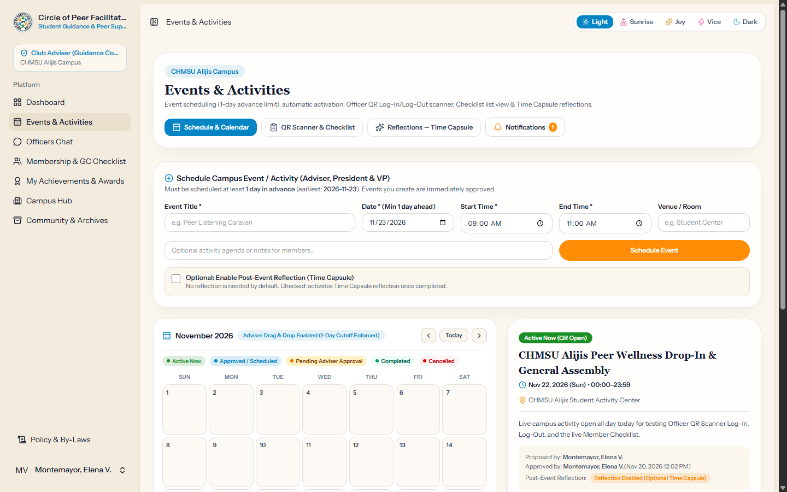
*Figure 6.1 — Primary baseline in Soft Cream (Light) (`01_light.png`).*

Combines 1-day advance event scheduling, Adviser drag-and-drop calendar adjustments, Officer QR Log-In/Log-Out scanning, Reflections -> Time Capsule links, and Notifications. Post-Event Reflection is optional by default: Advisers toggle it directly, while President/VP changes require Adviser confirmation.

**Key Highlights:**
- Enforces 1-day advance event scheduling with automatic Active Now status activation and Adviser drag-and-drop.
- Optional Post-Event Reflection setting: disabled by default; President/VP requests require Adviser approval.
- Four workspace tabs: Schedule & Calendar, QR Scanner & Checklist, Reflections -> Time Capsule, and Notifications.

#### All Theme Variants — Events, Calendar, QR Scanner & Optional Reflections

| Twilight Calm (Dark) (`02_dark.png`) | Letter in Sunrise (`03_sunrise.png`) |
| :---: | :---: |
| 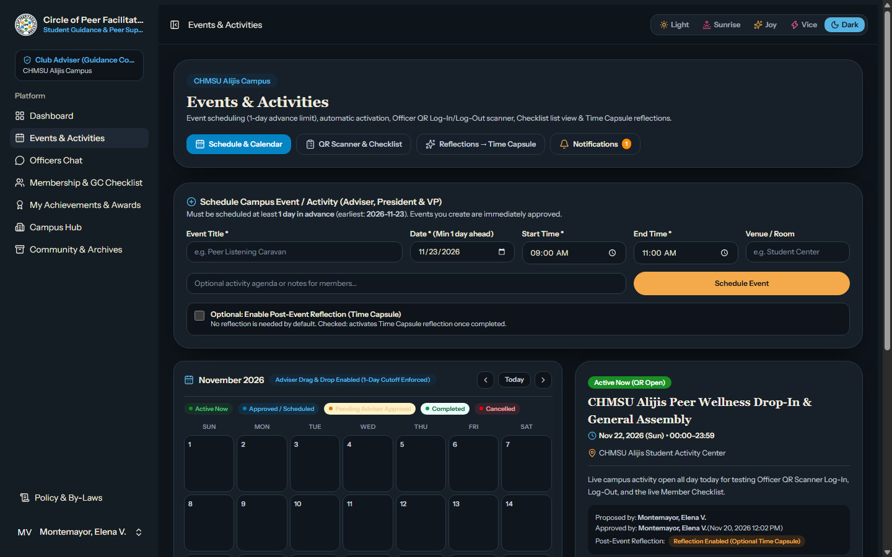 | 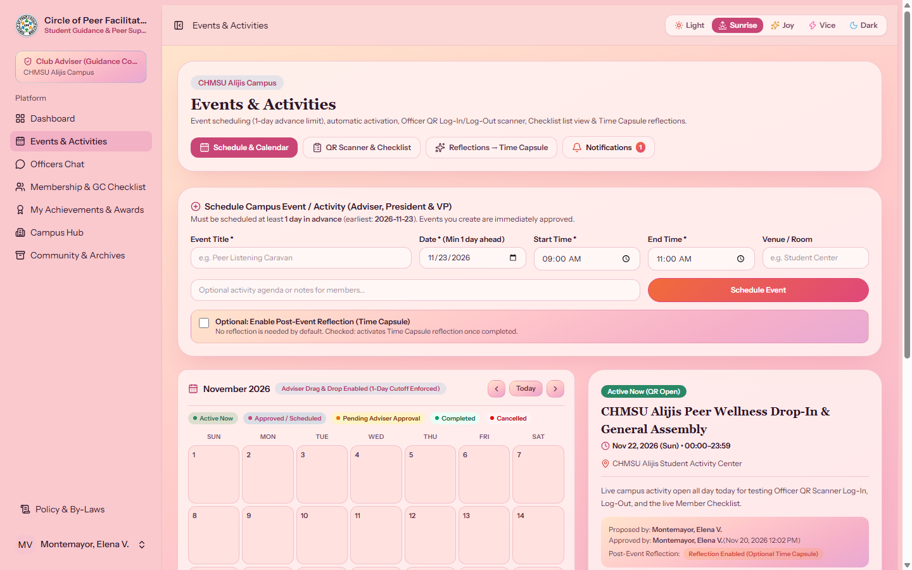 |

| In Little Blobs of Joy (`04_joy.png`) | Somehow, We Got Here Before Anything Worse (`05_vice.png`) |
| :---: | :---: |
| 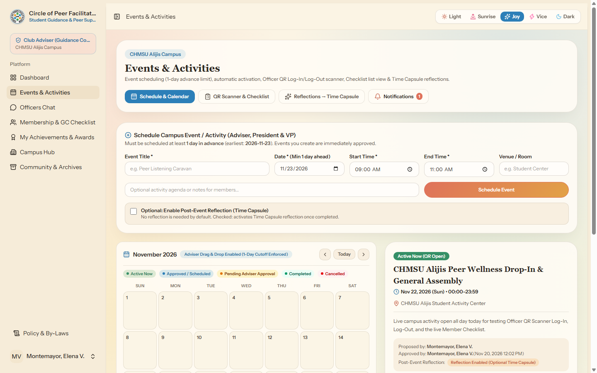 | 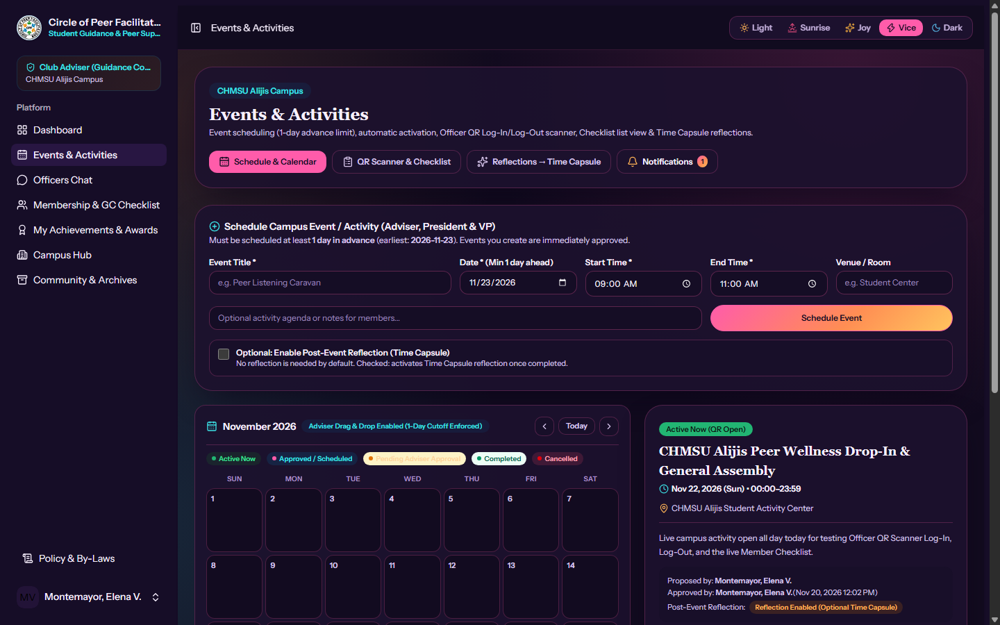 |

---

## PART III — Community, Governance & Support Hubs

> Sequential elections with member photos, AES-256 time capsules, campus counseling/testing room hub, officers' GC, and SHA-256 credentials.

### 7. Campus Elections Chamber & Constitutional Billboard

**Route:** `/community-hub  (Default Campus Elections Tab)`  
**Screenshot Folder:** [`screenshots/07-elections-chamber/`](screenshots/07-elections-chamber/)

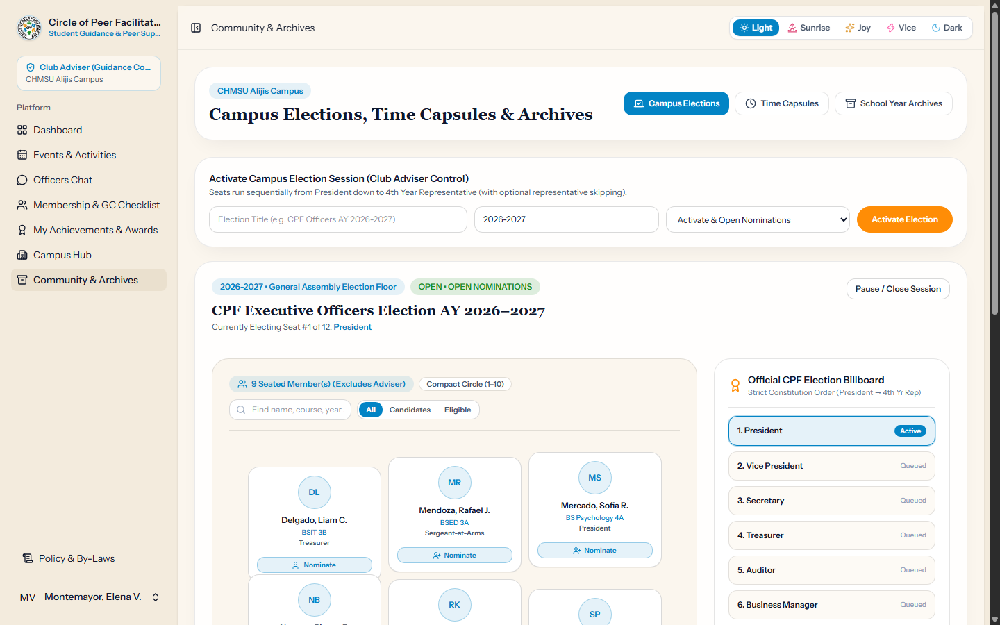
*Figure 7.1 — Primary baseline in Soft Cream (Light) (`01_light.png`).*

Manages sequential campus elections from Seat #1 (President) through 4th Year Representative alongside the Official CPF Election Billboard. Officers, members, and advisers upload a single profile picture in Settings that renders on seated candidate cards with name, course/year/section, and role.

**Key Highlights:**
- Single-photo member cards show uploaded portraits (or monogram fallbacks) with name, course/year, and role.
- Enforces strict Constitutional order on the Official CPF Election Billboard with Adviser session controls.
- Supports instant search & filtering (All, Candidates, Eligible) plus sequential nomination & opt-in flows.

#### All Theme Variants — Campus Elections Chamber & Constitutional Billboard

| Twilight Calm (Dark) (`02_dark.png`) | Letter in Sunrise (`03_sunrise.png`) |
| :---: | :---: |
| 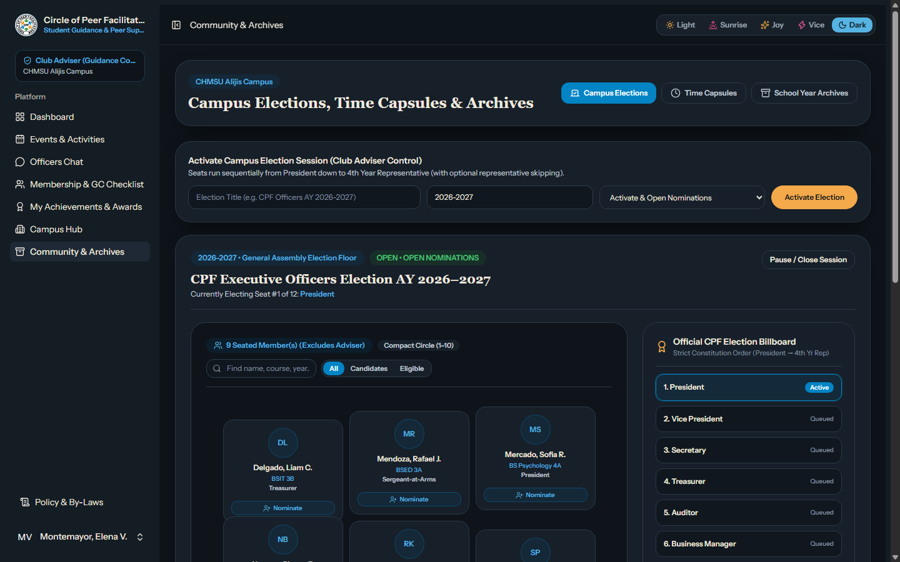 | 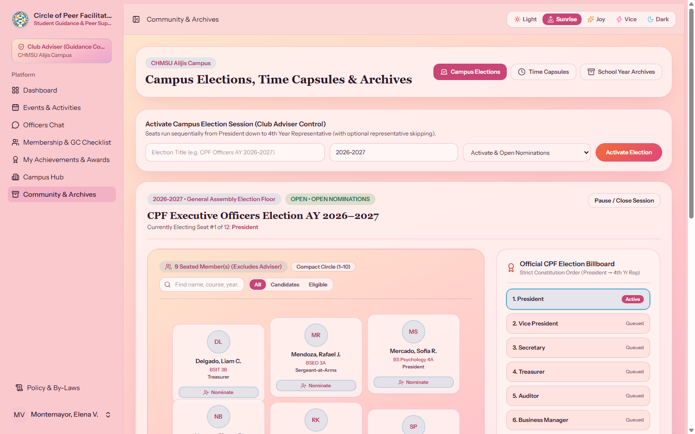 |

| In Little Blobs of Joy (`04_joy.png`) | Somehow, We Got Here Before Anything Worse (`05_vice.png`) |
| :---: | :---: |
| 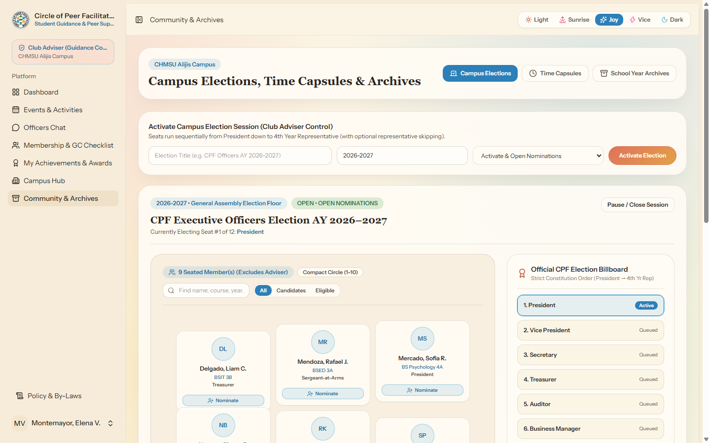 | 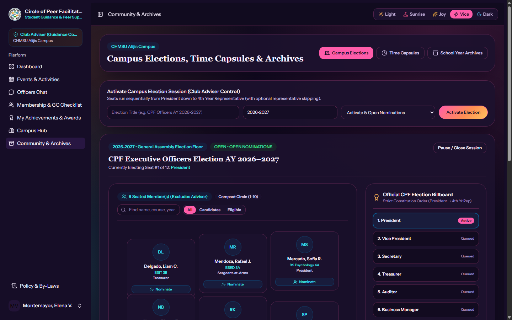 |

---

### 8. AES-256 Time Capsules & Five Stationery Varieties

**Route:** `/community-hub  (Time Capsules Tab)`  
**Screenshot Folder:** [`screenshots/08-time-capsules/`](screenshots/08-time-capsules/)

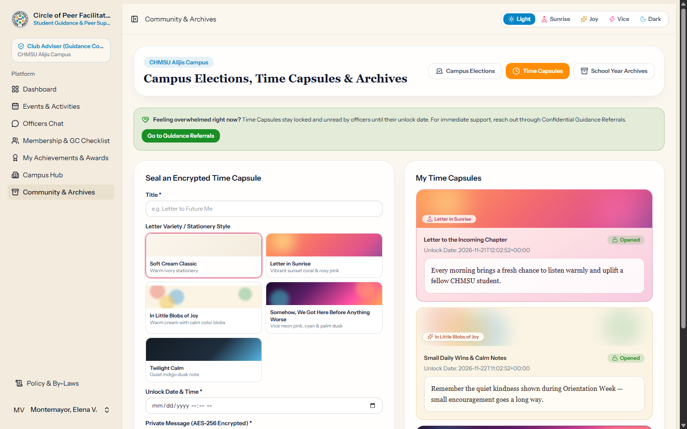
*Figure 8.1 — Primary baseline in Soft Cream (Light) (`01_light.png`).*

Lets peer facilitators compose AES-256 encrypted letters sealed until a chosen unlock date & time, paired with a Confidential Guidance Referrals safety banner. Composers pick from five stationery varieties: Soft Cream Classic, Letter in Sunrise, In Little Blobs of Joy, Vice Dusk, and Twilight Calm.

**Key Highlights:**
- Five distinct Letter Variety / Stationery Styles matching CPF's full visual identity palette.
- AES-256 encrypted private message storage locked strictly until the configured unlock date and time.
- Displays Opened and Sealed capsule cards cleanly with stationery headers and unlock timestamps.

#### All Theme Variants — AES-256 Time Capsules & Five Stationery Varieties

| Twilight Calm (Dark) (`02_dark.png`) | Letter in Sunrise (`03_sunrise.png`) |
| :---: | :---: |
| 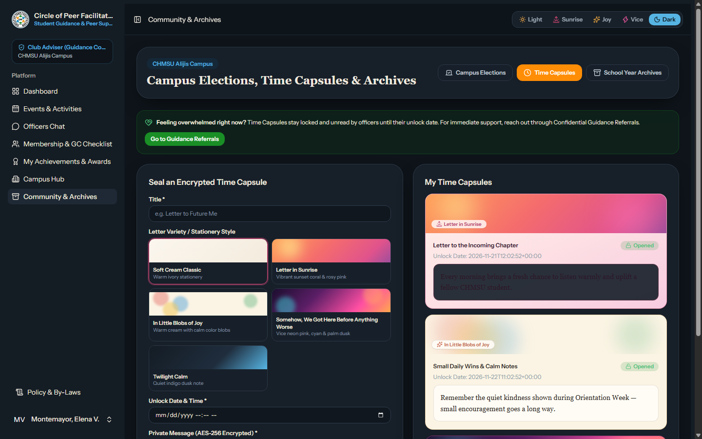 | 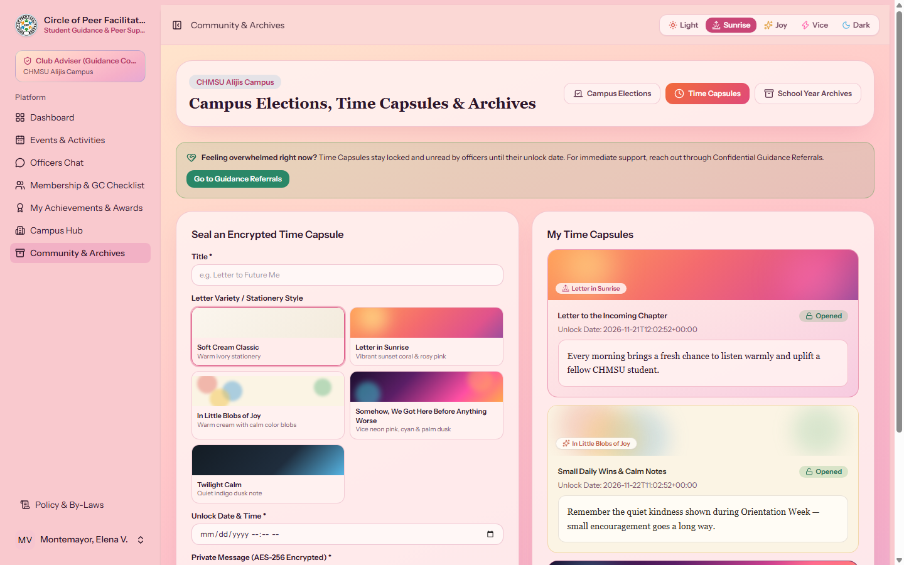 |

| In Little Blobs of Joy (`04_joy.png`) | Somehow, We Got Here Before Anything Worse (`05_vice.png`) |
| :---: | :---: |
| 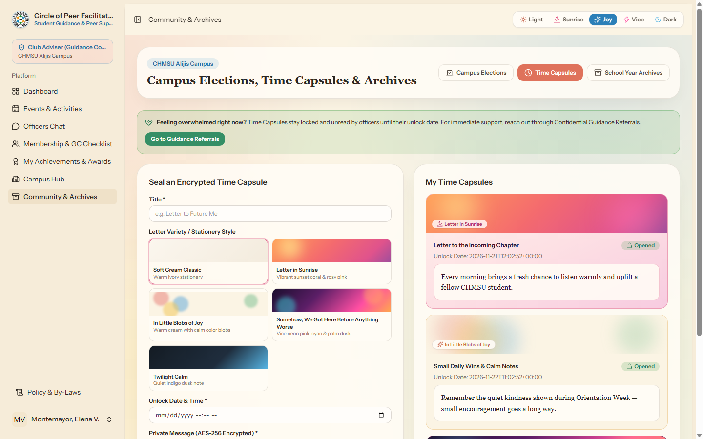 | 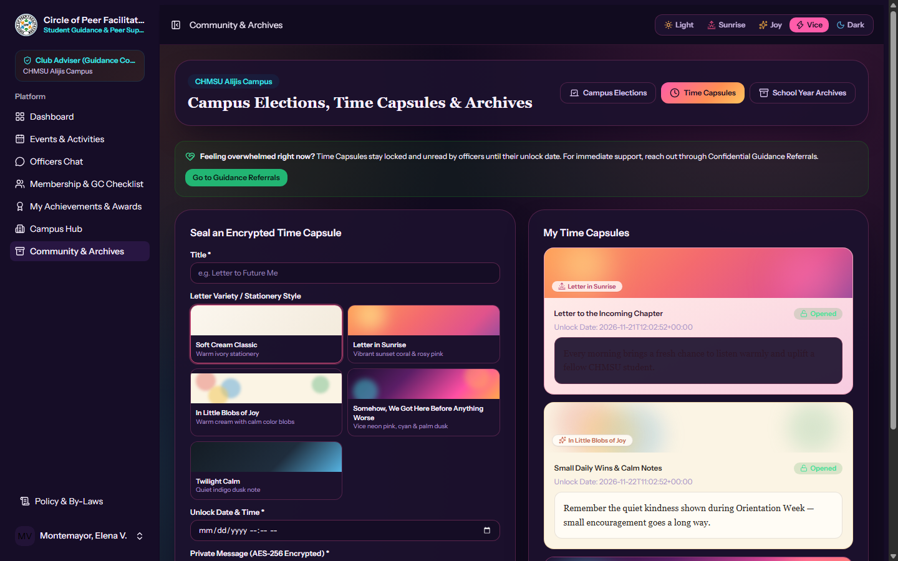 |

---

### 9. Campus Support & Operations Hub

**Route:** `/campus-hub  (Authenticated Verified Member)`  
**Screenshot Folder:** [`screenshots/09-campus-operations/`](screenshots/09-campus-operations/)

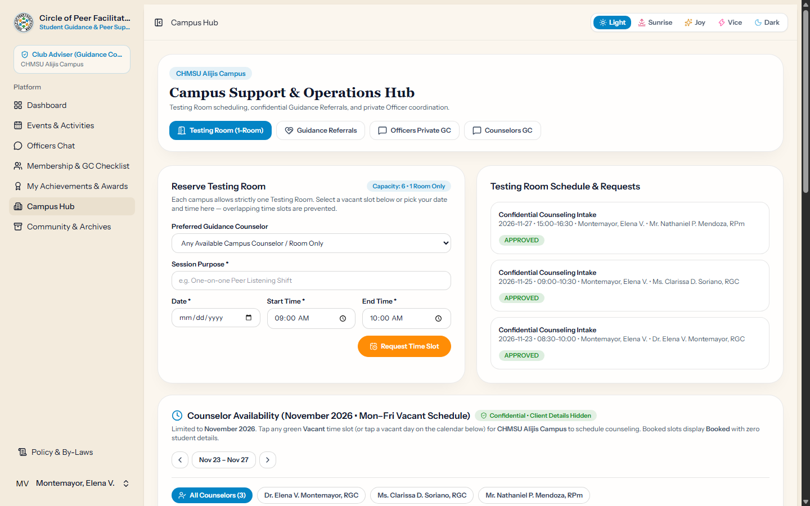
*Figure 9.1 — Primary baseline in Soft Cream (Light) (`01_light.png`).*

Coordinates single-room Testing Room reservations (capacity-checked to prevent overlapping time slots), confidential Guidance Referrals, weekly Mon–Fri Counselor Availability grids (with student details redacted on public slots), and quick tabs to Officers Private GC and Counselors GC.

**Key Highlights:**
- Strictly enforces single Testing Room reservation scheduling per campus to avoid overlapping sessions.
- Mon–Fri Counselor Availability grid masks confidential client details while surfacing vacant green time slots.
- Unified top tabs spanning Testing Room (1-Room), Guidance Referrals, Officers Private GC, and Counselors GC.

#### All Theme Variants — Campus Support & Operations Hub

| Twilight Calm (Dark) (`02_dark.png`) | Letter in Sunrise (`03_sunrise.png`) |
| :---: | :---: |
| 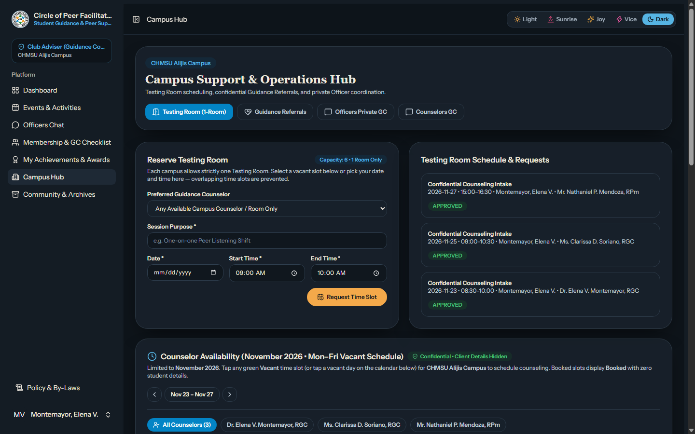 | 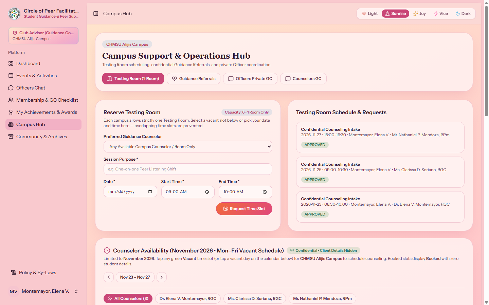 |

| In Little Blobs of Joy (`04_joy.png`) | Somehow, We Got Here Before Anything Worse (`05_vice.png`) |
| :---: | :---: |
| 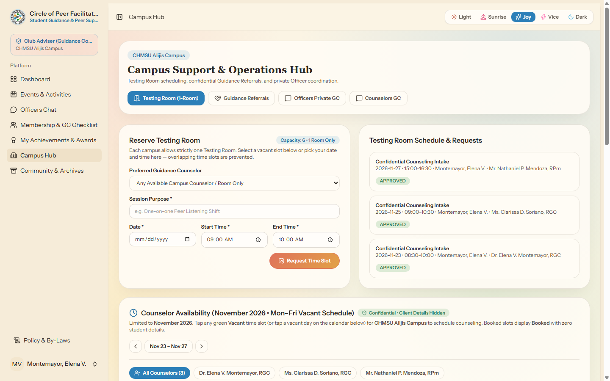 | 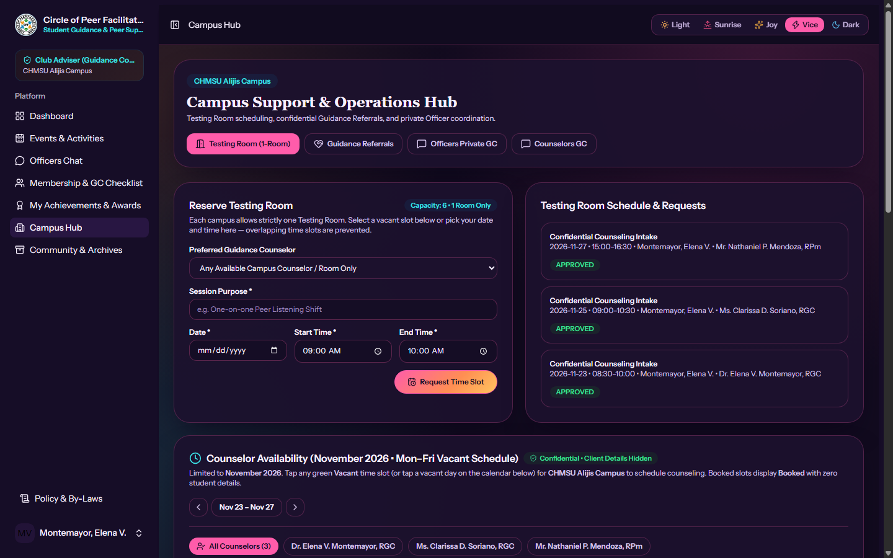 |

---

### 10. Officers Private Group Chat & Annual ZIP Archives

**Route:** `/officers-chat  (Officers, Advisers & Counselors)`  
**Screenshot Folder:** [`screenshots/10-officers-chat/`](screenshots/10-officers-chat/)

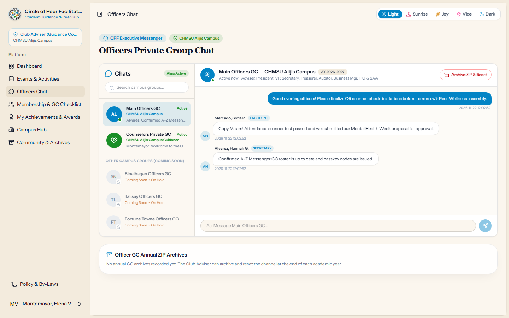
*Figure 10.1 — Primary baseline in Soft Cream (Light) (`01_light.png`).*

Provides Messenger-style executive group communication for Main Officers GC (Adviser, President, VP, Secretary, Treasurer, Auditor, Business Mgr, PIO & SAA) and Counselors Private GC, complete with annual Club Adviser ZIP export & channel reset at academic year handover.

**Key Highlights:**
- Active threads for Main Officers GC and Counselors Private GC alongside Coming Soon campus chapters.
- Color-coded role badges (e.g., PRESIDENT, SECRETARY) identify executive senders inside each message bubble.
- Archive ZIP & Reset workflow lets the Club Adviser archive academic-year logs cleanly during handover.

#### All Theme Variants — Officers Private Group Chat & Annual ZIP Archives

| Twilight Calm (Dark) (`02_dark.png`) | Letter in Sunrise (`03_sunrise.png`) |
| :---: | :---: |
| 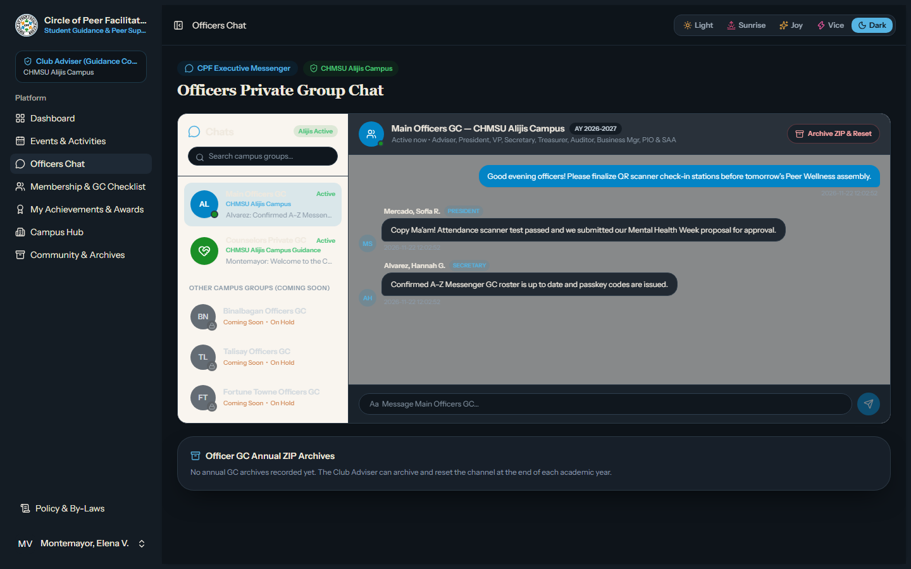 | 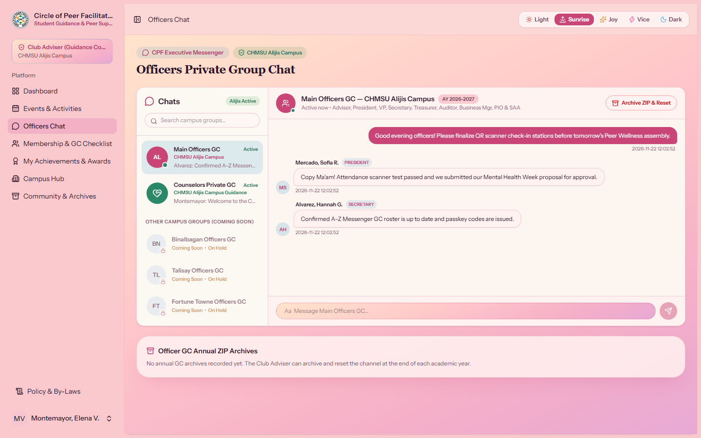 |

| In Little Blobs of Joy (`04_joy.png`) | Somehow, We Got Here Before Anything Worse (`05_vice.png`) |
| :---: | :---: |
| 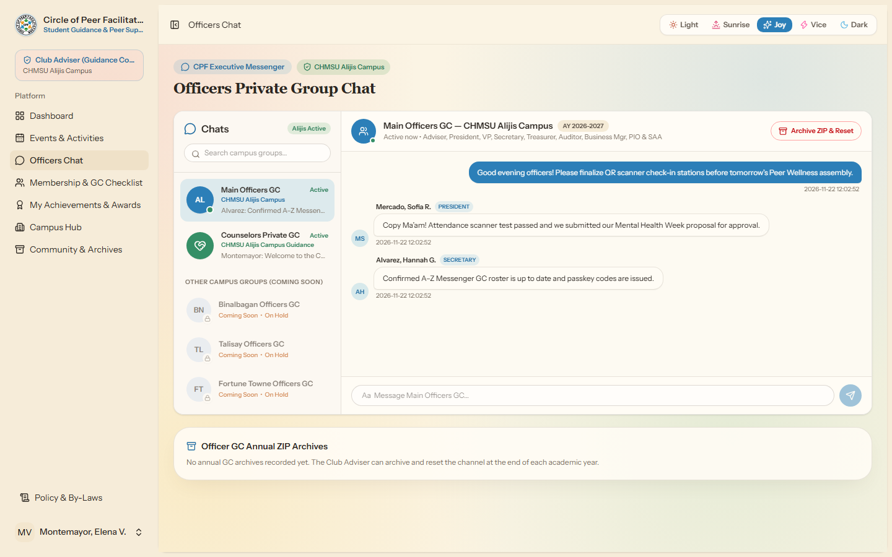 | 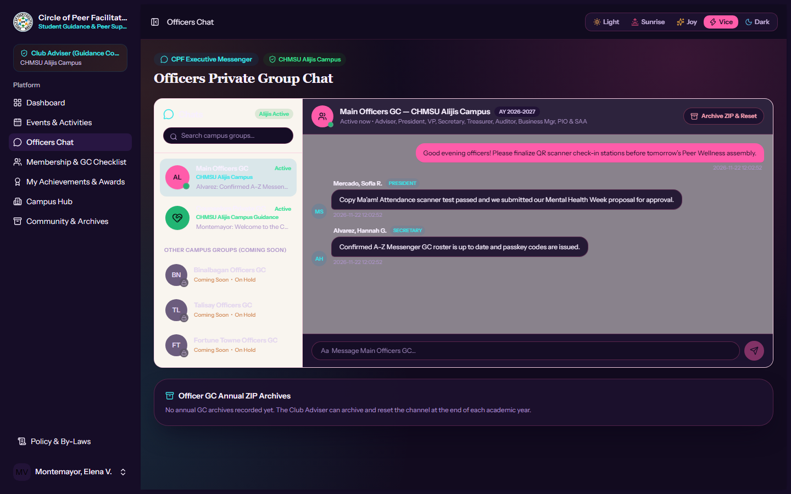 |

---

### 11. Blockchain-Protected Achievements, Awards & Certificates

**Route:** `/my-credentials  (Authenticated & Public Verification)`  
**Screenshot Folder:** [`screenshots/11-blockchain-credentials/`](screenshots/11-blockchain-credentials/)

*Figure 11.1 — Primary baseline in Soft Cream (Light) (`01_light.png`).*

Anchors peer facilitator achievements, service awards, and digital certificates on a tamper-evident SHA-256 hash chain (cpf-local-chain) displaying live ledger integrity status, anchored block counts, and instant credential code or SHA-256 hash verification lookup.

**Key Highlights:**
- Displays live Ledger Integrity Verified badge with anchored block count and SHA256 network details.
- Interactive Verify Any Code or Hash lookup bar validates certificates, awards, and achievements publicly.
- Each record exposes its block index, truncated proof hash preview, issuer attribution, and Verify Proof button.

#### All Theme Variants — Blockchain-Protected Achievements, Awards & Certificates

| Twilight Calm (Dark) (`02_dark.png`) | Letter in Sunrise (`03_sunrise.png`) |
| :---: | :---: |
|  |  |

| In Little Blobs of Joy (`04_joy.png`) | Somehow, We Got Here Before Anything Worse (`05_vice.png`) |
| :---: | :---: |
|  |  |

---

## PART IV — Personalization & Account Settings

> Single-avatar profile photo uploads for election seats, account preservation rules, and five-palette appearance controls.

### 12. Profile Information & Single Avatar Upload

**Route:** `/settings/profile  (Authenticated Verified Member)`  
**Screenshot Folder:** [`screenshots/12-profile-and-photo/`](screenshots/12-profile-and-photo/)

*Figure 12.1 — Primary baseline in Soft Cream (Light) (`01_light.png`).*

Allows every officer, member, and adviser to upload a single profile picture (JPG, PNG, or WebP up to 2 MB) displayed on Election Seats and member identification badges, update account details, and documents the Account Preservation Notice protecting audit trails.

**Key Highlights:**
- Single Profile Picture slot (Visible on Election Seats) replaces prior portrait seamlessly via Choose Photo.
- Authenticated photo serving (/profile-photos/{targetUser}) protects chapter member imagery from unauthenticated scraping.
- Account Preservation Notice explains why self-service account deletion is disabled across all CPF roles.

#### All Theme Variants — Profile Information & Single Avatar Upload

| Twilight Calm (Dark) (`02_dark.png`) | Letter in Sunrise (`03_sunrise.png`) |
| :---: | :---: |
|  |  |

| In Little Blobs of Joy (`04_joy.png`) | Somehow, We Got Here Before Anything Worse (`05_vice.png`) |
| :---: | :---: |
|  |  |

---

### 13. Appearance Settings & Theme Palette Varieties

**Route:** `/settings/appearance  (Authenticated Verified Member)`  
**Screenshot Folder:** [`screenshots/13-appearance-themes/`](screenshots/13-appearance-themes/)

*Figure 13.1 — Primary baseline in Soft Cream (Light) (`01_light.png`).*

Showcases visual swatch previews for all five Theme Palette Varieties—Soft Cream, Twilight Calm, Letter in Sunrise, In Little Blobs of Joy, and Somehow, We Got Here Before Anything Worse—plus System auto-detection synced live with every page's header Theme Mode Switcher.

**Key Highlights:**
- Five visual swatch cards plus System option update the entire UI instantaneously without reload.
- Every card previews its live gradient/blob backdrop and 4-swatch palette markers with Active badge state.
- Designed cleanly across light parchment (Soft Cream / Joy), vibrant coral-pink (Sunrise), twilight slate (Dark), and neon dusk (Vice).

#### All Theme Variants — Appearance Settings & Theme Palette Varieties

| Twilight Calm (Dark) (`02_dark.png`) | Letter in Sunrise (`03_sunrise.png`) |
| :---: | :---: |
|  |  |

| In Little Blobs of Joy (`04_joy.png`) | Somehow, We Got Here Before Anything Worse (`05_vice.png`) |
| :---: | :---: |
|  |  |

---
